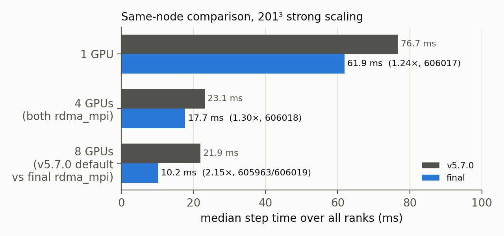
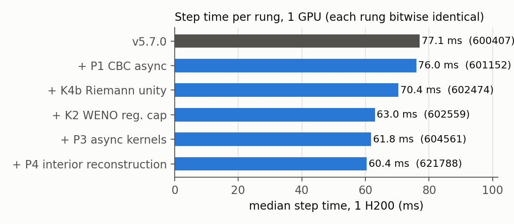
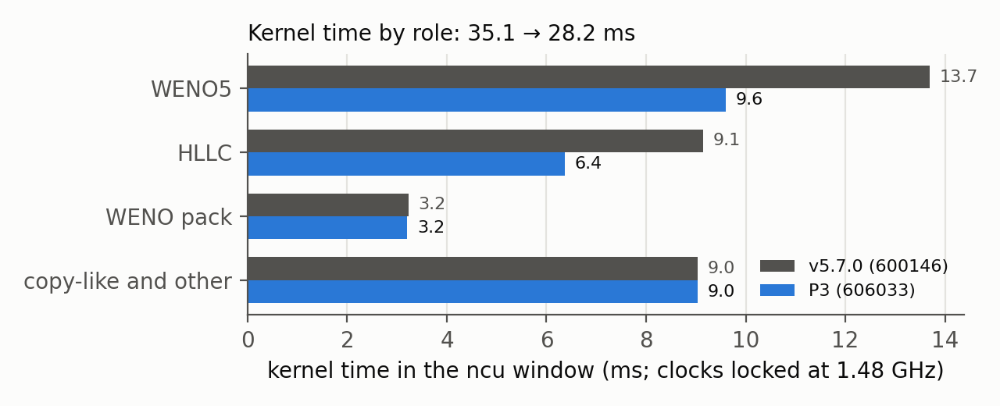

# MFC on NCHC nano4 H200 — making an SC26 application faster without changing its answer

Coding-Adv-HW-1. We made **MFC v5.7.0** (`0b3d56c`), the SC26 Student Cluster Competition application, run faster on
nano4's H200 GPUs without changing its answer by a single bit. MFC simulates moving gases and liquids: it cuts space
into small boxes (*cells*) and moves time forward in *steps*. A GPU is a chip with thousands of small cores.

Every number cites a Slurm job (a numbered batch job). Our changes are patches in `patches/opt/`: §1–§10 are the
10-31 report (`0001…0006`), §11 the later work P7–P22. Every rejected idea: `docs/ladder.md`. Agent mistakes:
`AGENT_LOG.md`.

**Update (2026-11-03, after the deadline):** at 1 GPU, in one same-node A/B (job 686551, every run bitwise identical),
v5.7.0 takes 76.90 ms per step, P20 (patches 0001–0024) 29.68 ms (2.59×) and P21 (0001–0030) 28.27 ms (2.72×).
In a later one (690631, hgpn011) v5.7.0 takes 77.74 ms, P21 28.46 ms (2.73×) and **P22 (0001–0031) 28.37 ms: 2.74×
faster**. The full GPU test suites on P21 and P22 show only the 23 failures that v5.7.0 also has, with the same errors as
P20. Details in §11.

## 1. Result

*Step* = median time of one step (steps 2–30) on the slowest GPU. *Grind* = MFC's cost figure: nanoseconds per cell,
per equation, per RHS (one "how fast is everything changing" calculation). Lower is better.

We compare builds on the same node in the same job (an *A/B*): v5.7.0 vs P3 (patches 0001–0005) in one job, P3 vs
the final build P4 (+ 0006) in another; the speedup multiplies the two ratios. All outputs are bitwise identical.

| GPUs | v5.7.0 step | P3 step | Final step | Speedup | v5.7.0 grind | Final grind | Jobs |
|---|---|---|---|---|---|---|---|
| 1 | 76.74 ms | 61.88 ms | **60.38 ms** | **1.27×** | 0.3973 | 0.3123 | 606017; 621788 |
| 4 (all `rdma_mpi`) | 23.10 ms | 17.72 ms | **17.03 ms** | **1.35×** | 0.1184 | 0.0876 | 606018; 622305 |
| 8 (v5.7.0 default, then `rdma_mpi`) | 21.94 ms | 10.22 ms | **9.75 ms** | **2.23×** | 0.1129 | 0.0502 | 605963 / 606019; 622306 |



*Strong-scaling efficiency* asks: do N GPUs give N times the speed? Final build: 89 % at 4 GPUs, 77 % at 8. v5.7.0 at
its defaults: 44 % at 8.

Caveat: the 8-GPU row compares v5.7.0 at its defaults with our settings (`rdma_mpi=T`). The fair v5.7.0 `rdma_mpi`
run never ran: an agent bug (AGENT_LOG #14) used up the budget. In a different job, v5.7.0 with `rdma_mpi` took
16.5 ms per step at 8 GPUs (`docs/profiling-baseline.md`).

## 2. Rules we held ourselves to
- Same equations, methods, grid, steps and FP64 precision. No looser tolerances, no changed outputs.
- **Bitwise gate on every run:** the final state (65 M numbers) must match v5.7.0 in every bit (`harness/verify.py`).
  Every `src/` change must pass MFC's test suite (`./mfc.sh test`, tolerance 1e-12) with no failure that unmodified
  MFC does not also show.
- Source changes must be fit to send upstream: small, and portable to both GPU paths (OpenACC and OpenMP, two ways of
  telling the compiler "run this on the GPU").
- Timing: warm-up, ≥3 runs (final: 5), medians, A/B on one node. Failures are reported.

## 3. Setup
- nano4 nodes: 8× H200 (141 GB, NVLink), 2× Xeon 8480+, 10 network cards (HCAs). NVHPC 26.3 (CUDA 13.1, OpenACC),
  HPC-X 2.25.1 Open MPI 4.1.9. MPI runs one copy of the program (*rank*) per GPU; ranks send each other messages.
- Case: MFC's benchmark `examples/3D_performance_test` (two fluids, WENO5-M, HLLC, RK3, FP64, 201³ cells, 30 steps).
- Scripts in `harness/` run, log (`results/jobs.tsv`), test and check every job.
- Setup fixes (no effect on the math): `mpirun` instead of `srun`, no OMPI core binding, ROMIO instead of OMPIO.

## 4. Starting point: where the time went
Each step has three sub-steps (*RK stages*). **WENO5** estimates the values on the walls between cells, and the
**HLLC Riemann solver** decides what flows through each wall. A *kernel* is one function the
GPU runs on many cells at once.

- **1 GPU:** 77.06 ms per step (600407). WENO5 34 %, HLLC 25 %, plain copy kernels ≈25 % using only ~30 % of memory
  speed (ncu 600146; `docs/profiling-baseline.md`). MFC's published 0.38 ns uses a different metric
  (`baseline/README.md`).
- **8 GPUs:** each GPU owns a box of cells and needs copies of its neighbours' edge cells (*ghost cells*). Swapping
  them (*halo exchange*) took 53 % of a stage, going through CPU memory. With `rdma_mpi=T`, the rank with more CBC
  faces (CBC = a special rule for the outer walls that lets waves leave) spent 0.9 ms more per stage on the *CPU*
  (tiny kernels + waits), and the others waited for it.
- **Plan:** first stop the CPU from waiting on the GPU so often, then make the kernels faster.

## 5. What we changed, and what it gained

Ladder at 1 GPU (each rung on top of the one before; all bitwise):

| Rung | Step | Grind | Job |
|---|---|---|---|
| v5.7.0 | 77.06 ms | 0.3982 | 600407 |
| P1 CBC async | 75.98 ms | 0.3935 | 601152 |
| K4b Riemann unity build (final slice: 70.00 ms, 602531) | 70.42 ms | 0.3632 | 602474 |
| K2 WENO register cap | 62.99 ms | 0.3255 | 602559 |
| P3 async per-stage kernels (same-node A/B 62.87 → 61.79) | 61.79 ms | 0.3201 | 604561 |
| P4 transverse-interior reconstruction (same-node A/B 61.90 → 60.38) | 60.38 ms | 0.3123 | 621788 |



**P1 — boundary code without CPU waits** (`0001`). Each CBC call sent ~12 small GPU jobs, and the CPU waited after
each one (~230 µs per call), like a cook standing at the oven after every dish. Now the jobs are queued (*async*) and
the CPU waits once. −1.4 % at 1 GPU, −2.3 % at 4 GPUs (601183 vs 601184, different nodes).

**K4b — let the compiler paste in the Riemann helpers** (`0002`+`0003`, CMake + 3 lines). HLLC was 42 % slower than in
v4.9.3. nvfortran *inlines* GPU helper routines (pastes their body into the caller) only within one source file, so
9 real calls remained, each passing data through slow memory. (A compiler message misled us at first, AGENT_LOG #11.)
Fix: compile the Riemann modules and the ones they use as one unit. HLLC 18.7 → 12.9 ms/step.

**K2 — let more WENO threads run at once** (`0004`, one compiler flag, disclosed). *Registers* are each core's tiny,
fastest storage, like desk space: the more each thread needs, the fewer threads fit. WENO5 needed 188–196. A cap of
128 doubles the threads; a few values *spill* to slower memory, but to the fast L1 cache. Caps 168 / 128 / 96 → 64.0 / 63.0 / 66.5 ms per step.

**P3 — no CPU wait per kernel** (`0005`, 10 files). Each RK stage still launched 44–68 kernels and ~45 small updates,
each followed by a CPU wait: ~1.2 ms of idle GPU per stage, which does not shrink with more GPUs. Now the 115
directives that run every stage are queued, with one wait before data goes to MPI. Same-node
A/B: 4 GPUs 18.81 → 17.71 ms (−5.8 %); 1 GPU −1.7 %.

**P4 — compute only what the Riemann solver reads** (`0006`). WENO also filled 4 ghost cells on each side in the sideways
(*transverse*) directions, which the only reader, the Riemann solver, never looks at. Now it skips them. The skipped share grows as boxes shrink (7.5 % of a sweep at 201³ per GPU, 14 % at
101³), so more GPUs gain more. Same-node A/B against P3: 1 GPU **−2.5 %** (621788), 4 GPUs **−3.5 %** (622305),
8 GPUs **−4.0 %** (622306). Bitwise in all 8 runs.

**`rdma_mpi=T`** (MFC input setting, disclosed): ghost cells go GPU→GPU over NVLink instead of through CPU memory.
−27 % per step at 4 GPUs (602770 vs 604560, different nodes); bitwise.

**T0.4 — faster MPI start-up** (environment, disclosed). `MPI_Init` took 5.8–6.5 s at 4 ranks (602722/602764),
because UCX (the layer under MPI) opens all 10 network cards. `harness/nicbind.sh` gives each rank only the card next
to its GPU. With CPU-memory halos each step got 4.5 % slower (rejected); with `rdma_mpi=T` it is free: 4 GPUs, same node (606032), step 17.65 → 17.69 ms (noise), **wall 13.03 → 9.28 s (−29 %)**.

## 6. What did not work
| Idea | Result | Job |
|---|---|---|
| NVHPC 25.9 instead of 26.3 | no gain, not bitwise | ladder row 1 |
| Fixed sweep direction in HLLC (K4a) | worse (255 registers); real cause was missing inlining | ladder row 3 |
| WENO `vector_length(64/96)` | registers rose to 206 / 192 in a compile check; not timed | `results/k2/kcheck_vector_length.txt` |
| WENO register cap 96 | too many spills, 66.5 ms | 602567 |
| HCOLL/UCC off | no clear effect | 602638/9, 602683 |
| one network card per rank, CPU-memory halos | −3 s start-up, +4.5 % per step | 602770/1 |
| `ob1`/vader, UCX shm | ranks could not reach each other / no gain | 602704/26 |

## 7. Correctness
- Every benchmark run: final state bitwise identical to v5.7.0.
- **Full test suite on P4** (713 tests ran, jobs 622349–622356): **690 pass, 23 fail, 0 new failures**. P3 gave the
  same 23.
- **All 23 fail the same way on unmodified v5.7.0** here (606331). They are 17 `model_eqns=3` / viscous IBM cases,
  five examples and one reactive-burn case that does not start (`harness/known_test_failures.txt`). So our changes
  alter no test result, but v5.7.0's suite is not clean on NVHPC 26.3 / H200, and we say so.
- Two holes in our own scripts, found and closed: `verify.py` once passed a run that never timed anything
  (AGENT_LOG #12); 1-GPU test jobs could not start 2-rank tests.

## 8. Why it runs at this speed now
Per-kernel profile (ncu 600146 vs 606033, P3; clocks locked, so times are longer but ratios hold).

| Kernel (per call) | v5.7.0 | P3 | Why |
|---|---|---|---|
| WENO5 | 3.39–3.49 ms; 188–196 regs; 12 % warps active | **2.34–2.56 ms**; 128 regs; 24 % | K2: twice the threads |
| HLLC | 2.13–2.48 ms | **1.57–1.62 ms** | K4b: helpers inlined |
| Copy-like (pack, flux difference, RK update, conversion) | 0.72–1.19 ms; 24–37 % of memory peak | unchanged | busy with index math, not memory |
| All listed kernels | 35.10 ms | **28.20 ms (−19.7 %)** | |



- WENO5 still waits more than it computes; the copy kernels are busy computing array positions. Both are next.
- 8 GPUs (P3): the halo exchange takes 0.36–0.72 ms per stage (606019), as 6 one-after-another `MPI_Sendrecv`s with
  no compute running alongside.

## 9. What we would do next
1. Compute the interior while the halo exchange runs (possible now that P3 removed the CPU waits).
2. Merge or skip the plain copy kernels (40 % of kernel time).
3. Send P1/K4b/P3/P4 upstream as small PRs.

## 10. Reproduce
On nano4, from this repository mirrored to `/work/u1131128/coding-adv1`:
```
bash harness/reproduce.sh build    # v5.7.0 + every patch in patches/opt/ (0001-0024), case-opt + generic builds
bash harness/reproduce.sh run      # the final 1/4/8-GPU same-node sets (harness/specs/final_*g.tsv)
bash harness/reproduce.sh verify   # bitwise gate + median step per run
```
Multi-GPU runs with `rdma_mpi` add `WRAP=$ROOT/harness/nicbind.sh` (T0.4).

## 11. Later work (2026-11-01, updated 11-03): P7–P22

Same rules: every run bitwise identical to v5.7.0, A/B on one node against the rung below. Details:
`docs/ladder.md` and `docs/optimizations.md`.

**1 GPU** (v5.7.0 vs P16, same node, 2 rounds × 5 runs, job 669752):

| | v5.7.0 | P16 | Gain |
|---|---|---|---|
| Step | 77.06 ms | **36.23 ms** | **2.13×** |
| Grind (ns) | 0.3968–0.3985 | 0.1872–0.1877 | 2.12× |
| Wall, default setup | 7.31 s | 5.65 s | 1.29× |

v5.7.0 vs P18 (job 670158): step **76.75 / 76.74 → 34.39 / 34.30 ms, 2.24×**; bitwise. P19 takes another 3.4 % off
(670619) and P20 another 10.5 % (671002): about 2.59× if the A/Bs are multiplied.

**Direct check, v5.7.0 vs P20 (2026-11-03, same node, 2 rounds × 3 runs, job 680943; all bitwise):**

| | v5.7.0 | P20 | + 0025 | + 0025 + 0026 |
|---|---|---|---|---|
| Step | 77.806 / 77.778 ms | 29.837 / 29.815 ms | 29.635 / 29.636 ms | **29.511 / 29.460 ms** |
| vs v5.7.0 | 1× | **2.61×** | 2.62× | 2.64× |
| Grind (ns, first run) | 0.4027 | 0.1538–0.1539 | 0.1527 | 0.1519 |

0025 runs the CBC primitive-to-flux conversion on the GPU queue instead of making the CPU wait; 0026 fills each ghost
value with its own GPU thread. Both were held in `patches/pending/` until the full suite (P21, below) passed. The first try of this job (680922) stopped itself in 4 s: its node had the power brake on.

0027: with WENO3/5 the CBC kernels overwrite every flux value the boundary routine copies
back, so it no longer copies the fluxes in, and copies back only the layers it changed. Job 681650 (hgpn011):
29.501 / 29.501 → 29.021 / 29.014 ms; job 683029 (hgpn001): 29.265 / 29.252 → 28.807 / 28.802 ms; −1.6 % both times,
every arm bitwise. All 34 CBC tests pass (682349). Multiplying the two A/Bs gives about 29.0 ms, about 2.68×.
On 4 GPUs (`rdma_mpi`, same node, job 685059) the three pending patches take P20's step from 8.989 / 9.032 to
8.529 / 8.504 ms (−5.4 %, bitwise), twice their 1-GPU gain, because boundary work is a bigger share there. The 49
boundary-condition tests give 45 passes and the 4 known failures, unchanged from P20 (684975, 685001).
0028 queues the small CBC kernels on a second OpenACC queue so they run alongside the Riemann solve:
28.813 / 28.772 → 28.586 / 28.585 ms at 1 GPU (−0.7 %, job 685237, bitwise); the 5 suite tests that take that path pass
(685267). On 4 GPUs it takes 8.556 → 8.315 ms (−2.8 %, 685274, bitwise), because there the other ranks wait for
the rank with the most CBC faces. Chaining the A/Bs: about 28.8 ms at 1 GPU (about 2.70× v5.7.0) and about −8 % per
step vs P20 at 4 GPUs. 0029 runs that second queue on a high-priority CUDA stream, found through dlopen/dlsym so no
build flag changes: −0.35 % at 1 GPU (685381) and 8.299 → 8.065 ms (−2.8 %) at 4 GPUs (685404), bitwise. With 0025–0029,
about −11 % per step vs P20 at 4 GPUs (chained A/Bs). 0030 skips the per-cell ghost-cell kernel on faces
whose cells are all extrapolation/CBC or reflective, where the fast path has already filled them: 28.689 / 28.657 →
28.440 / 28.478 ms at 1 GPU (−0.75 %, job 685452, bitwise). Chaining all six: about 28.5 ms at 1 GPU (about 2.73×
v5.7.0). With 0025–0030 the 34 CBC and 49 boundary tests give 79 passes and the 4 known IBM-viscous failures, with the same
errors as P20 (685533).

**P21 = v5.7.0 + 0001–0030 (2026-11-03).** Full suite (713 tests, 8 shards, ladder row 67): 690 pass, and the 23
failures are exactly the known ones, each with the same abs/rel error as P20; 0025–0030 moved to `patches/opt/`.
Measured directly against v5.7.0 and P20 (job 686551, hgpn030, 2 rounds × 3 runs, all bitwise):

| | v5.7.0 | P20 | P21 |
|---|---|---|---|
| Step (median, round 1 / 2) | 76.831 / 76.966 ms | 29.675 / 29.686 ms | **28.258 / 28.281 ms** |
| vs v5.7.0 | 1× | 2.59× | **2.72×** |
| Grind (ns, median of 6 runs) | 0.3976 | 0.1532 | 0.1458 |
| Wall (s, median of 6 runs; range) | 7.57 (7.44–7.68) | 5.56 (5.47–5.76) | 5.63 (5.42–5.87) |

P21 is 4.75 % faster per step than P20; the wall time is the same within noise. The chained estimate above (about
2.73×) was close. P21's first step takes 57 ms instead of 36: the first host-to-device copy on the CBC queue (0028)
makes the OpenACC runtime allocate a pinned staging buffer (21 ms `cuMemHostAlloc`, nsys 685403), once per run.
Queuing those copies on the default queue instead removes the 21 ms but costs 0.15 % per step (686710, ladder row 68).
0031 writes the same values on the GPU with one single-block kernel that takes them as arguments: first step
56.6 / 57.6 → 35.7 / 35.8 ms, grind 0.14566 → 0.14522 ns (−0.30 %), bitwise (686808); all 34 CBC tests pass (686876). On 4 GPUs (`rdma_mpi`,
686954): 8.032 → 7.927 ms per step (−1.3 %), bitwise.

**P22 = v5.7.0 + 0001–0031 (2026-11-03).** Full suite (713 tests, 8 shards, ladder row 70): 690 pass, the 23 known
failures with P20's exact errors; 0031 moved to `patches/opt/`. Measured directly (job 690631, hgpn011, 2 rounds × 3
runs, P21 and P22 arms bitwise):

| | v5.7.0 | P21 | P22 |
|---|---|---|---|
| Step (median, round 1 / 2) | 77.741 / 77.733 ms | 28.474 / 28.452 ms | **28.355 / 28.387 ms** |
| First step (round 1 / 2) | 82.97 / 82.89 ms | 59.37 / 57.19 ms | 35.27 / 35.76 ms |
| vs v5.7.0 | 1× | 2.73× | **2.74×** |
| Grind (ns, median of 6 runs) | 0.4021 | 0.1468 | 0.1464 |
| Wall (s, median of 6 runs; range) | 8.47 (7.36–10.28) | 5.63 (5.37–5.92) | 5.48 (5.24–5.89) |

**Pending 0032 (multi-GPU only; not in P22).** An nsys profile of P22 on 4 GPUs (690700) showed the GPU 10–12 % idle,
with two 14–19 µs gaps in each halo exchange while the host waited on MPI. 0032 fills the y/z ghost cells on a
second OpenACC queue after the x sweep is queued, so that sweep runs while the host waits; it applies only with an MPI
neighbour in y or z and RDMA halos. 4 GPUs (690856): step 7.921 → 7.781 ms (−1.8 %), halo exchange 0.29–0.36 →
0.20–0.22 ms per step, bitwise; 1 GPU unchanged (path off). The 7 two-rank MPI tests with `--rdma-mpi` pass (690903),
of which the 3D RDMA case takes the new path. It stays in `patches/pending/` because its full suite (~120 GPU-min) was
not run (ladder row 71).

**Pending 0033 (on 0032; not in P22).** A profile of P22 + 0032 on 4 GPUs (690931) cut GPU idle per step from 0.65–0.88
to 0.43–0.55 ms (vs 690700) and showed the next gap: before every Riemann solve, 10 tiny asynchronous host-to-device
copies of the direction's index bounds and direction arrays, which the GPU runs one after another with 3–5 µs between
them (~50 µs per direction where no CBC work hides them). 0033 writes the same values with one single-thread kernel, as
0031 did for CBC. 4 GPUs (691553): 7.780 → 7.721 ms per step (−0.76 %), grind −0.62 %, bitwise; 1 GPU (691872): no
change, bitwise. 155 targeted tests (every hypoelastic and Riemann-solver test) pass apart from the 6 known failures
in that set (ladder row 72). Full suite not run.

**Tried and rejected: overlap the x exchange too (exp-haloxs).** On 0033, the x sweep was split so that the faces that
read no x ghost cell on an MPI side run while the host waits on the x exchange, and the 3 faces next to that side run
after it. 4 GPUs (692179): 7.698 → 7.725 ms per step (+0.35 %), bitwise. A profile (692237) shows why: the exchange
waits for the neighbour rank, not for the transfer (17 µs), so the wait moves into the y/z exchange, and the edge
faces add a 37 µs kernel. The ranks with more CBC sides set the pace: rank 3 (CBC on 3 sides) runs 701 µs of CBC
kernels per step, rank 0 (1 side) 239 µs (ladder row 73).

**Several GPUs** (`rdma_mpi`, same node, P11 vs P18; bitwise):

| GPUs | P11 step | P18 step | Change | Job |
|---|---|---|---|---|
| 4 | 12.294 ms | **10.131 ms** | −17.6 % | 670516 |
| 8 | 7.344 ms | **6.115 ms** | −16.7 % | 670540 |

Scaling efficiency drops to about 85 % at 4 GPUs and 70 % at 8 (P4: 89 % and 77 %): the compute shrank, the halo
exchange did not. The fair v5.7.0 multi-GPU A/B was not run.

**What changed** (one patch each). Two terms: a *slab* is one big array holding many fields; a *descriptor* is the
small card Fortran keeps for each array (start, size), which the GPU must read before it can find a value.

| Rung | Patch | Change | 1 GPU step | Job |
|---|---|---|---|---|
| P7 | 0007–0009 | Leaner copy kernels and buffers | 60.95 → 45.10 ms | 664597 |
| P8–P11 | 0010–0014 | Merged steps; register cap 128; no CBC CPU waits | → 42.04 ms | 664763–664895 |
| P12 | 0015 | **HLLC computes its own WENO5 values** in one kernel per direction | → 37.71 ms (−10.5 %) | 668372 |
| P13 | 0016 | Flux slabs; all three flux differences in one pass | → 36.83 ms (−2.4 %) | 669254 |
| P14 | 0017 | Flux differences merged into the RK update | → 36.24 ms (−1.9 %) | 669327 |
| P15 | 0018 | Build fix: chemistry GPU builds failed to link since 0012 | — | suite |
| P16 | 0019 | Check the saved state for NaN on the GPU, not the CPU | save 1.1–1.25 → 0.6–0.74 s | 669490 |
| P17 | 0020 | Load the next inputs one round early | 36.66 → 35.90 ms (−2.1 %) | 670011 |
| P18 | 0021 | Same idea in the RK update | 35.88 → 34.51 ms (−3.8 %) | 670088 |
| P19 | 0022 | RK update reads flux slabs directly (one descriptor, not three) | 34.27 → 33.12 ms (−3.4 %) | 670619 |
| P20 | 0023–0024 | Fixed-size slabs (0023); no self-copies in cons→prim (0024) | 33.09 → **29.63 ms (−10.5 %)**, bitwise | 670687, 670779, 670811, 671002 |
| P21 | 0025–0030 | Boundary work: CBC without CPU waits or dead copies, on a second high-priority queue (0025, 0027–0029); ghost cells one thread per value, idle per-cell pass skipped (0026, 0030) | 29.68 → **28.27 ms (−4.75 %)**, bitwise; about −11 % at 4 GPUs (chained) | 686551 (direct); 680943, 683029, 685237, 685381, 685452 (steps) |
| P22 | 0031 | CBC device state set by one small kernel, so its queue makes no host copies (no 21 ms staging-buffer set-up) | 28.46 → **28.37 ms (−0.32 %)**, first step 58 → 36 ms, bitwise; −1.3 % at 4 GPUs | 690631 (direct), 686808, 686954 |

P20 came from a line-by-line profile (ncu 670130): 16 % of the merged kernel's instructions only found addresses
through descriptors.

**Correctness.** Full suite on P15 (jobs 669500–669511), P18 (670591–670598 + make-up 671033), P20 (0001–0024, so
it covers P19; jobs 672459–672470), P21 (0001–0030; 685708, 685821, 685825–685829, 685933) and P22 (0001–0031;
689787–689791, 689793, 689794, 689934): each time the same 713 tests, and the failures are exactly the 23 known ones. The
first P18 run silently skipped 59 tests; a make-up job ran them, and `run_suite.sh` now lists tests explicitly. MFC's
39 "Convergence" tests try to rebuild MFC on the GPU node and failed or timed out there; they say nothing about the math and are
now left out.

**Wall time (environment setting, disclosed).** At 1 GPU the biggest cost outside the steps was `MPI_Init`, which
opens the network cards even for one rank. Not loading UCX at all
(`OMPI_MCA_pml=ob1 OMPI_MCA_btl=self,vader OMPI_MCA_osc=^ucx`) cut the median wall time from 5.556 s (669785) to
**4.300 s** (669940). With P16, 1-GPU wall goes from 7.31 s (v5.7.0) to about 4.3 s, about 1.7× (different jobs). This
is for one rank only; multi-GPU runs need a GPU-aware transport, which we did not compare.

**Run directory in node-local memory (setting, disclosed; 2026-11-03).** With `ob1` on, a CPU-sampling profile
(684723) showed what is left of start-up is reading the 520 MB initial state from Lustre, and the save is a slow
pageable copy plus the Lustre write. Running the case directory in `/dev/shm` and copying it back afterwards, untimed,
cut the median wall time from 4.039 to **3.810 s (−5.7 %)** on the exp-cbcdead binary (684750: 3 rounds × 5 reps,
every round agrees; final state bitwise). A bigger OpenACC copy buffer for the save made it slower (684697).

**What did not work (all bitwise, all measured):** WENO kernel `collapse(4)` +15.7 %; other register caps on the
merged kernel (+0.8 % to +7 %); RK update variants (+3.6 %, +7.5 %, +15 %); saving through an MPI-IO memory datatype
(+70 %), a staging buffer or ROMIO hints (no gain); packed WENO coefficients (no gain, 670870); RK update per (cell,
equation) (+1.7 ms, 670933); delayed velocity stores in cons→prim (slower, 671032).

**Where the time is now** (P20, 1 GPU, per RK stage, nsys 670902): merged WENO5+HLLC 6.87 ms (68 %), RK update
1.50 ms (15 %), cons→prim 0.63 ms, boundaries 0.25 ms.

**Reproduce.** `harness/reproduce.sh` applies every patch in `patches/opt/` (0001–0031). The canonical nano4 tree
is branch `exp-cbcdevset` (worktree `mfc-cbcdevset`, P22; the same source tree as `git am patches/opt/*.patch`); its
full suite shows only the known failures. P21 stays in `mfc-bcskip`, P20 in `mfc-p20`.
