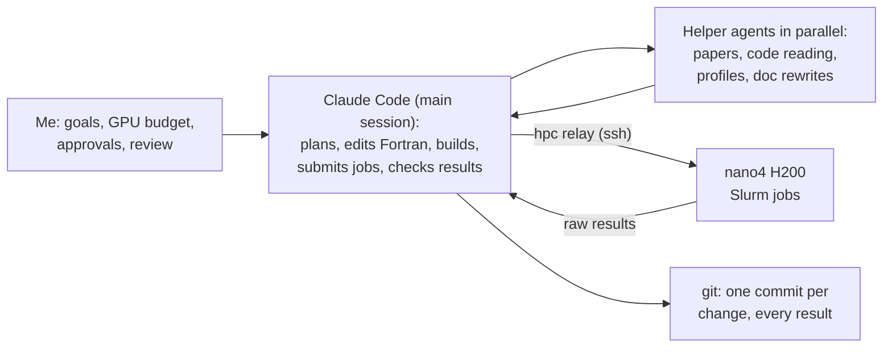

CODING-ADV HW1 · SC26 STUDENT CLUSTER COMPETITION

# MFC on one H200 GPU: 2.6× faster, same answer to the last bit

What we changed, how we checked it, and how an AI agent did the work

[Your name] · NTHU · 2026-11-11

<!--
Hi everyone. Our homework was to take one of the SC26 competition applications and make it faster. We picked MFC, a
fluid-flow simulator, on nano4's H200 GPUs. One time step went from about 78 ms to about 30 ms, 2.6 times faster,
and the output is identical to the original program down to the last bit. I'll show what we changed, how we proved
nothing broke, and how we used an AI agent for most of the hands-on work.
-->

---

# The benchmark and the rules

### Benchmark

- **MFC v5.7.0**: a fluid-flow solver in Fortran, run on the GPU with OpenACC
- 3-D flow of two fluids, **201 × 201 × 201 cells**, 7 equations
- WENO5 reconstruction + HLLC Riemann solver + 3-stage Runge–Kutta, all in FP64
- **30 time steps on one H200** of nano4

### Rules we kept

- Output **bit-for-bit identical** to v5.7.0
- MFC’s full test suite: **no new failures**
- Every change works for both **OpenACC and OpenMP**, small enough for an upstream pull request
- Every number names its **Slurm job id**

Figure of merit: median time per step (steps 2–30) and MFC’s grind time (ns per cell, per equation, per RHS call)

<!--
The case is MFC's own 3-D performance test: two fluids on a 201-cubed grid, fifth-order WENO plus the HLLC solver,
third-order Runge-Kutta, double precision, 30 steps on one GPU. The rules come from the SC26 spirit: no physics
shortcuts. Every run is compared with the original bit by bit, MFC's full test suite must show no new failures, and
the code must stay portable so it could go upstream.
-->

---
layout: center
class: dark text-center
---

THE RESULT · 1 GPU · SAME NODE, SAME JOB (686551)

76.9 ms → 28.3 ms

per time step: <strong>2.72× faster</strong>, every run bit-for-bit identical to v5.7.0

10-31 report (P4): <strong>1.27×</strong>

P20 (patches 0001–0024): <strong>2.59×</strong>

Full test suite on P21: <strong>same 23 failures as v5.7.0</strong>

<!--
This is the headline. Original and optimized builds ran in the same job on the same node, taking turns, so the
comparison is fair: 76.9 ms per step versus 28.3, 2.72 times faster. At the 10-31 report we were at 1.27 times; P20,
the version before the last six boundary patches, is 2.59 times in the same job. The full suite on the final version
fails exactly the 23 tests that already fail on the original, with the same errors.
-->

---

# Where the GPU time goes

<Split title="Before: v5.7.0 + first compiler fixes (sc26, nsys 602705)" :parts="[
  { label: 'WENO5', pct: 29, color: '#7FA6E8' },
  { label: 'HLLC', pct: 21, color: '#A9C4F0' },
  { label: 'pack', pct: 10, color: '#D3DEEF' },
  { label: 'plain copy kernels', pct: 40, color: '#8A93A6', dark: true },
]" />

<Split title="Now: P20 (nsys 670902)" :parts="[
  { label: 'WENO5 + HLLC in one kernel', pct: 68, color: '#2F6FDB', dark: true },
  { label: 'RK update', pct: 15, color: '#A9C4F0' },
  { label: 'cons→prim', pct: 6, color: '#D3DEEF' },
  { label: 'boundaries', pct: 2, color: '#E8833A' },
  { label: 'other', pct: 9, color: '#8A93A6', dark: true },
]" />

- At the start, **40 % of GPU time was plain copying**: arrays reshaped or duplicated before the real math.
- Now **the real math is 68 %**, so the GPU spends its time on physics, not on moving data.

<!--
Here is where the GPU time went. Early on, 40 percent of kernel time was copy kernels: arrays reshaped or duplicated
before the actual math. Now the main kernel, which does the WENO5 reconstruction and the HLLC solver together, is 68
percent. Most of our speedup came from removing data movement, not from making the arithmetic faster.
-->

---

# The ladder: every kept step, 1 GPU

<Ladder />

Median ms per step. Each bar is the new arm of that step’s own same-node A/B; all arms bitwise. Rejected attempts: docs/ladder.md

<!--
Every bar is one kept step, each measured against the step before it on the same node. The light-blue part was done
by the 10-31 report. The big drops after that are P7, removing copies, P12, putting WENO5 inside the HLLC kernel, and
P20, simpler array addressing; P21 is the boundary work. Every arm of every comparison was checked bit for bit.
-->

---

# Four ideas did most of the work

### 1 · Stop waiting
The CPU queued each GPU job and then waited for it. Now it queues everything and moves on.

0001 0005 0013 0019 0025 0028 0029

### 2 · Stop copying, skip unused work
Arrays were copied before being read, and some cells computed that nobody used. Now kernels read in place and skip them.

0006–0009 0011 0024 0026 0027 0030

### 3 · One pass, not four
WENO5 runs inside the HLLC kernel; flux differences go straight into the Runge–Kutta update.

0010 0015 0016 0017

### 4 · Help the compiler and memory
One-file build so helpers inline, register limits, load the next values early, plain arrays instead of descriptors.

0003 0004 0012 0020–0023

30 patches in patches/opt/, one idea each; every one explained in docs/optimizations.md

<!--
The 30 patches fall into four ideas. One, stop waiting: the CPU used to wait after each GPU job. Two, stop copying:
read arrays in place. Three, do in one pass what used to take several: the biggest one put WENO5 inside the HLLC
kernel. Four, help the compiler and the memory system: inlining, register limits, loading the next values early,
and simpler array addressing.
-->

---

# Example 1: WENO5 inside the HLLC kernel (P12)

Before

cell values

→

WENO5 kernel

→

big array of face states written, then read back

→

HLLC kernel

→

fluxes

After

cell values

→

one kernel per direction: WENO5 in registers → HLLC

→

fluxes

- The face states never touch GPU memory: no write, no read-back, one launch instead of two
- **42.04 → 37.71 ms per step (−10.5 %)**, bitwise identical (job 668372)

<!--
Example one. Before, a WENO kernel wrote reconstructed values at every face into a large array, and the HLLC kernel
read them back. Now one kernel per direction reconstructs in registers and feeds the solver directly, so that array
never touches memory. That alone took 10.5 percent off the step time, with identical results.
-->

---

# Example 2: plain arrays instead of descriptors (P20)

- Each Fortran array carries a **descriptor**, a small record of where it lives. The GPU reads it before it can find a value.
- A line-by-line profile (ncu 670130) showed **16 % of the main kernel’s instructions** only worked out addresses.
- Fix: keep the state in **one big array with a fixed shape**, so an address is just base + a known offset.

instructions to load one variable’s stencil (x sweep)

66 → 22

<strong>33.09 → 29.63 ms (−10.5 %)</strong> bitwise, full suite clean

<!--
Example two came from a line-by-line profile. Fortran keeps a small record, a descriptor, for every array, and the
GPU must read it before it can find a value. 16 percent of the main kernel's instructions were just address math. We
put the state into one array with a fixed shape, so the compiler knows every offset. Loading one variable's stencil
went from 66 instructions to 22, and the step from 33.1 to 29.6 ms.
-->

---

# What did not work

| Idea | Result (all bitwise) |
|---|---|
| Register limits on the fused RK update: 128 / 96 / 64 | **+1.3 % / +7.1 % / +13.3 %** slower: spills cost more than extra threads gain |
| `collapse(4)` on the WENO kernel | **+15.7 %** |
| RK update with one thread per (cell, equation) | **+1.7 ms** per step |
| RK update also writes the primitives, so the next step skips a conversion | **0.0 %**: the work just moved |
| Saving output through an MPI-IO memory datatype | **+70 %** |
| Packed WENO coefficients per cell | no gain |

Every attempt, kept or not, with its job id: docs/ladder.md · patches/exp/

<!--
Not everything worked, and we kept all of it in the log. Register limits made things slower because values spilled
to memory. Several rewrites of the Runge-Kutta update were slower or no better. Each of these was measured the same
way, and each one is in the ladder file with its job id.
-->

---

# How we know the answer did not change

### Bit-for-bit check
Every run’s final state is compared with v5.7.0’s. Every A/B arm here shows a **maximum relative error of 0.0**: identical, not just close.

### Same-node A/B
Old and new builds **take turns in one job on one node**. A node with its power brake on is refused automatically.

### Full test suite
**713 MFC tests** on the final version. The failures are exactly the **23 that fail on plain v5.7.0**.

<!--
Three checks. First, every run's final state is compared with the original's bit for bit; pass means exactly zero
difference. Second, every speed claim comes from old and new builds taking turns on the same node, and the harness
refuses nodes whose power brake is on, which we learned the hard way. Third, MFC's own 713-test suite, where the
final version fails the same 23 tests as the original.
-->

---

# How the AI agent did the work

- **Rules file (CLAUDE.md)**: 1 GPU by default, ask before anything over ~30 GPU-minutes, commit often, never trust a helper’s numbers
- The agent did the edit → build → run → verify loop; I set direction, budget, and checked the claims

<!--
How we used the agent. I set the goals, the GPU budget and the approvals. The main Claude Code session planned the
work, edited the Fortran, built on the login node, submitted Slurm jobs through a relay, and checked the results.
For reading papers, reading code and rewriting docs it ran helper agents in parallel. A rules file kept it honest:
one GPU by default, ask before big jobs, commit every change, and never trust a helper's numbers without checking
the raw files.
-->

---

# What the agent got wrong, and the rule that followed

| Mistake | Rule now |
|---|---|
| A check said PASS for a run that crashed: an old output file was still there | Delete old output before the timed runs |
| “94/94 tests pass” was actually a CPU run, not the GPU | A suite counts only if it ran in GPU mode |
| Called a suite clean while 59 tests had not run | Complete means every test ID ran |
| An 8-GPU run approved at ~40 GPU-min cost 67 | Estimate from an earlier job of the same shape |
| A sync deleted a live build log on the cluster | Sync skips folders that exist only on the cluster |

Every mistake, with its cost: AGENT_LOG.md

<!--
The agent made real mistakes, and we logged every one. A check passed a run that had crashed. A "94 out of 94 pass"
turned out to be a CPU run. A suite was called clean while 59 tests never ran. A job went well over its GPU budget.
Each mistake became a rule or a mechanical check. The lesson: the agent is fast and tireless, but every claim needs
a check that doesn't depend on trusting it.
-->

---
layout: center
class: dark
---

# Takeaways

13
days

200+
commits

256
GPU jobs

24
patches

1. **Moving less data** gave most of the speed, not faster math
2. **Measure on one node, check every bit**, keep every negative result
3. An AI agent is a fast engineer that **needs rules, a budget and mechanical checks**

Repo: [GitHub link] · report.md · docs/optimizations.md · AGENT_LOG.md

<!--
To sum up: 13 days, about 270 commits, about 300 GPU jobs, 30 patches. Most of the speed came from moving less data. Every claim
is measured on one node and checked bit for bit, and failures are kept. And an AI agent is a fast engineer, but it
needs rules, a budget and checks it can't talk its way around. Thanks, happy to take questions.
-->
